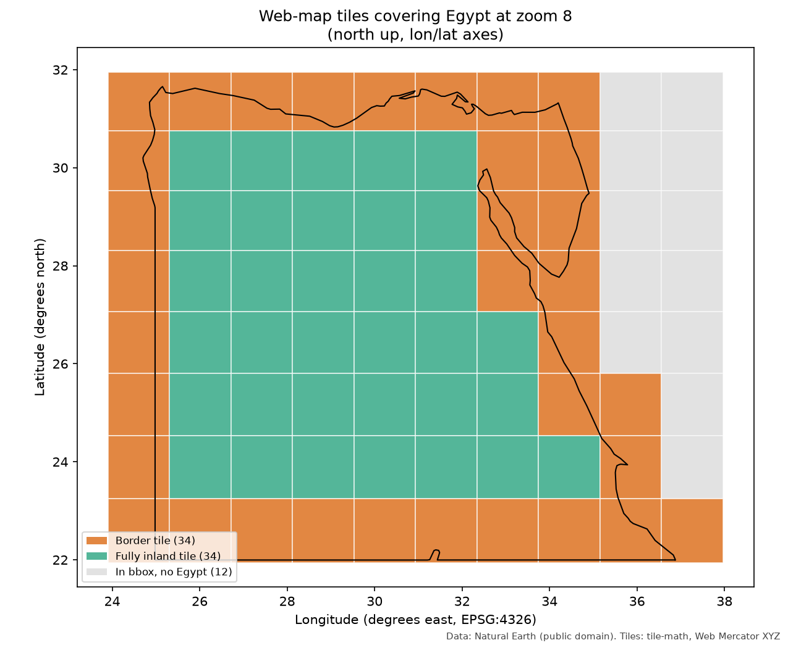

# tile-math

Convert between lat/lon, XYZ web-map tiles and quadkeys, and list the tiles covering a bounding box at a zoom level.

[](https://colab.research.google.com/github/AmmarYasser455/tile-math/blob/main/examples/demo.ipynb)
· [Demo map](https://ammaryasser455.github.io/tile-math/)

## Why

Tile servers, caches and tile-based datasets all address the world as `z/x/y` or quadkeys.
`tile-math` is a small helper for the common conversions, using the standard
Web Mercator (EPSG:3857) tile grid with y counted from the north (OpenStreetMap/Google scheme).

## Install

```
pip install git+https://github.com/AmmarYasser455/tile-math
```

Python >= 3.10; the only dependency is `pyproj` (used for the EPSG:4326 <-> EPSG:3857 projection).

## Command line

Coordinates are `lon lat` (x first), degrees, EPSG:4326. Bounding boxes are `west south east north`.

```
$ tile-math tile -0.1275 51.5072 10          # London
10/511/340 quadkey=0313131311

$ tile-math bounds 10 511 340
west=-0.3515625 south=51.39920565355377 east=0.0 north=51.6180165487737 quadkey=0313131311

$ tile-math quadkey 213
3/3/5

$ tile-math bbox -0.1275 48.8567 13.3833 52.5167 6     # London..Berlin, zoom 6
6/31/20
6/32/20
...
6/34/22

$ tile-math parent 10 511 340                # London tile, one level up
9/255/170

$ tile-math children 9 255 170
10/510/340
10/511/340
10/510/341
10/511/341

$ tile-math tile 0 89 3
tile-math: error: latitude must be within +-85.0511 for Web Mercator, got 89.0
```

`tile-math bbox ... --geojson` prints the tile polygons as GeoJSON; `--count` prints only the number of
tiles instead (and takes precedence over `--geojson`). `python -m tile_math` works too.

## Python

```python
>>> from tile_math import lonlat_to_tile, tile_to_quadkey, quadkey_to_tile, tile_bounds, bbox_to_tiles
>>> lonlat_to_tile(-0.1275, 51.5072, 10)
(511, 340, 10)
>>> tile_to_quadkey(3, 5, 3)
'213'
>>> quadkey_to_tile('213')
(3, 5, 3)
>>> bbox_to_tiles(-0.1275, 48.8567, 13.3833, 52.5167, 6)[:3]
[(31, 20, 6), (32, 20, 6), (33, 20, 6)]
```

`parent_tile(x, y, z, levels=1)` and `child_tiles(x, y, z)` move between zoom levels
(`parent_tile(511, 340, 10)` is `(255, 170, 9)`).

`tiles_to_geojson(tiles)` returns a GeoJSON FeatureCollection with `x`, `y`, `z`, `quadkey` properties.

## Example and demo

`examples/cities.geojson` holds five European capitals (see `examples/README.md` for the source). The
tiles covering their bounding box at zoom 6 are stored in `docs/demo.geojson` and shown on the
[demo map](https://ammaryasser455.github.io/tile-math/); a test checks the file matches the current
output. The walkthrough notebook is `examples/demo.ipynb`.

## Showcase

Which web-map tiles cover Egypt? Real Natural Earth data, a map, a short report and a notebook are in
[`showcase/`](showcase/) (rebuild with `python showcase/make_showcase.py`).



## Behaviour notes and limitations

- Latitudes outside +-85.0511 cannot be tiled: points raise `ValueError`; bounding boxes are clamped to that limit.
- A box with `west > east` is treated as crossing the antimeridian and returns tiles on both sides.
- Tiles that only touch the box edge are not included; points on a tile edge belong to the east/south tile.
- `bbox_to_tiles` refuses results above `max_tiles` (default 1,000,000).
- Only the Web Mercator XYZ scheme is supported (no TMS flipped y, no other grids), and tile bounds
  are in degrees, not metres.
- Invalid inputs (NaN/inf, `None`, strings, booleans, fractional tile indices or zooms) raise
  `ValueError`. Tile edges are matched with a small tolerance (1e-13 of the world width, i.e.
  `2**z * 1e-13` tile units, about 4 micrometres on the ground at any zoom) so projection roundoff
  does not add a neighbouring tile. Coordinates closer than that to a tile edge are treated as on it.
- City coordinates in the example are Wikidata reference points (mostly to the arc-minute), not survey positions.

## License

MIT, see `LICENSE`.
