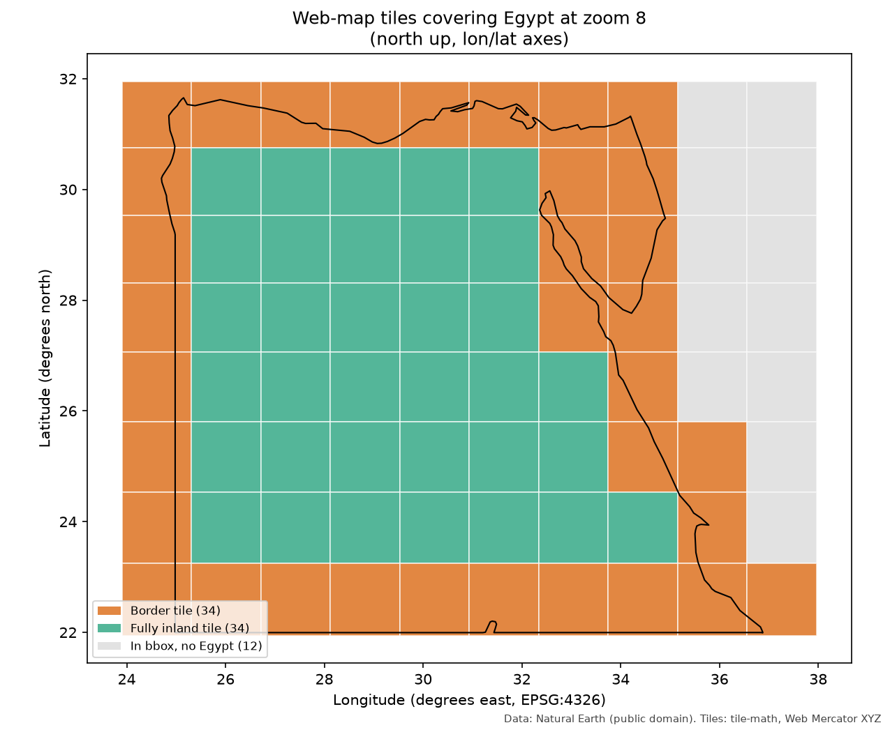

# Showcase: which web-map tiles cover Egypt?

**Question.** How many Web Mercator (XYZ) tiles are needed to cover Egypt at zoom 5 to 9, and how many of the tiles in Egypt's bounding box actually hold part of the country?

## Data

- File: `data/egypt.geojson`, the Egypt polygon (253 vertices, 4.6 KB) from Natural Earth 1:50m Admin 0 - Countries (`ADM0_A3 = EGY`), coordinates rounded to 4 decimals (about 11 m).
- Source: https://raw.githubusercontent.com/nvkelso/natural-earth-vector/master/geojson/ne_50m_admin_0_countries.geojson (https://www.naturalearthdata.com/)
- License: public domain (Natural Earth terms of use).
- Date fetched: 2026-11-15. The build runs offline from `data/`.

## Method

- CRS: EPSG:4326, lon/lat in degrees, x (longitude) first. Tiles use the Web Mercator XYZ grid (y counted from the north), as `tile-math` does.
- `bbox_to_tiles(west, south, east, north, z)` lists the tiles covering Egypt's bounding box.
- For each border segment, the candidate tiles come from `bbox_to_tiles` on the segment's bounding box, and each candidate's `tile_bounds` rectangle is clipped against the segment exactly (Liang-Barsky). A tile whose interior the segment passes through is `border`; touching only a tile edge or corner does not count. No sampling is involved, so a segment that clips a tile corner is still found.
- A tile the border does not cross lies entirely inside or entirely outside Egypt, so its centre (from `tile_bounds`) decides: inside the polygon is `interior`, otherwise `outside`.
- Tiles needed = `border` + `interior`. Segments are treated as straight lines in lon/lat (as GeoJSON edges are); the intersection and point-in-polygon tests work in degrees and are not a measurement of distance or area.
- `tiles_to_geojson` produces the tile polygons for `map.geojson`.

## Results

Egypt's bounding box is 24.70 to 36.87 E and 21.99 to 31.66 N.

| Zoom | Tiles in bbox | Border | Interior | Needed | Share needed |
|---|---|---|---|---|---|
| 5 | 2 | 2 | 0 | 2 | 100% |
| 6 | 6 | 6 | 0 | 6 | 100% |
| 7 | 24 | 16 | 5 | 21 | 87.5% |
| 8 | 80 | 34 | 34 | 68 | 85.0% |
| 9 | 288 | 74 | 162 | 236 | 81.9% |

- Each zoom step roughly quadruples the tile count in the box (6, 24, 80, 288 tiles from zoom 6 to 9).
- At zoom 8, 68 of 80 tiles are needed; the other 12 tiles in the box (15%) hold no part of Egypt by this test.
- At zoom 5 and 6 every tile in the box touches the border, so the bounding box is already the minimal set.



- Web map: [index.html](index.html) (Leaflet, needs network for the base map; serve the folder, e.g. `python -m http.server`, because the page fetches `map.geojson`)
- Notebook: [showcase.ipynb](showcase.ipynb)
- GeoJSON (zoom 8 tiles and the border): [map.geojson](map.geojson)

## Rebuild

```
python showcase/make_showcase.py
```

Writes `map.geojson`, `map.png` and `index.html` (needs matplotlib for the PNG). The notebook is run with
`python -m jupyter nbconvert --to notebook --execute --inplace showcase/showcase.ipynb`.

Map base layer on the web page: (c) OpenStreetMap contributors.
